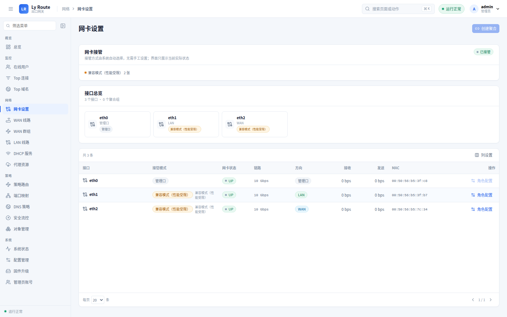

# Ly Route Gateway

Ly Route 网关是面向 **x86_64 / ARM64** 的出口网关发行版。数据面基于 VPP 26.06：
除管理口外，物理数据口默认由 VPP 以 **DPDK UIO** 接管，管理口保留在 Linux 内核；
同时提供 AF_PACKET 兼容回退与受控 AF_XDP 能力。


> **发布仓库说明**：本仓库只包含安装/升级产物、打包工程与第三方组件声明。
> 产品源代码不公开，软件使用受 [EULA](EULA.md) 约束。
>
> **平台**：x86_64 提供 ISO 与升级包；ARM64 提供 Armbian Bookworm 一键安装包与升级包。
> 二进制产物在 **Releases** 中，不在 git 文件树里。

## 下载

最新正式版：**[v1.2](https://github.com/kwrum1/ly-route/releases/tag/v1.2)**

| 平台 | 产物 | 用途 |
| --- | --- | --- |
| x86_64 | [`ly-route-gateway-gui-installer.iso`](https://github.com/kwrum1/ly-route/releases/download/v1.2/ly-route-gateway-gui-installer.iso) | 裸机安装（BIOS/UEFI，GUI 安装器） |
| x86_64 | [`ly-route-upgrade-gateway-bookworm-amd64.tar.zst`](https://github.com/kwrum1/ly-route/releases/download/v1.2/ly-route-upgrade-gateway-bookworm-amd64.tar.zst) | 1.2 原地升级 |
| ARM64 | [`ly-route-gateway-arm64-installer.tar.zst`](https://github.com/kwrum1/ly-route/releases/download/v1.2/ly-route-gateway-arm64-installer.tar.zst) | Armbian Bookworm 一键安装 |
| ARM64 | [`ly-route-upgrade-gateway-bookworm-arm64.tar.zst`](https://github.com/kwrum1/ly-route/releases/download/v1.2/ly-route-upgrade-gateway-bookworm-arm64.tar.zst) | ARM64 原地升级 |

校验文件：[`SHA256SUMS`](https://github.com/kwrum1/ly-route/releases/download/v1.2/SHA256SUMS)

> ARM64 产物（安装包与升级包）位于 **v1.2 Release 资产**中，不在 git 文件树里；
> 直接点击上表链接即可下载。当前 ARM64 形态为 Armbian Bookworm 一键安装包，不提供 ARM ISO。

## 安装

### x86_64：ISO 安装

1. 下载 ISO，用 `dd` 或 balenaEtcher 写入 U 盘；
2. 目标机选择 BIOS 或 UEFI 启动，进入 GUI 安装器；
3. 选择目标磁盘、管理网口，设置管理地址与管理员密码；
4. 执行安装并重启。

无 DHCP 时安装器回退到 `10.1.18.240/24`。安装完成后数据口按规则库自动接管为
`dpdk_uio`，控制面、VPP 与业务服务自动启动。首次登录强制修改密码。

### ARM64：Armbian Bookworm 一键安装

要求：已安装 **Armbian Bookworm arm64**（保留板卡内核 / DTB / 引导，不改 `/boot`），
root 权限，可访问 Debian 软件源；建议至少两个网口。

```bash
curl -fL -o /tmp/ly-route-arm64.tar.zst \
  https://github.com/kwrum1/ly-route/releases/latest/download/ly-route-gateway-arm64-installer.tar.zst
mkdir -p /tmp/ly-route-installer
tar --use-compress-program=unzstd -xf /tmp/ly-route-arm64.tar.zst -C /tmp/ly-route-installer
cd /tmp/ly-route-installer/ly-route-gateway-arm64-installer
sha256sum -c checksums.sha256
sudo ./install.sh
```

安装脚本幂等，可重复执行；已有 `/etc/ly-route/runtime.env` 与
`/etc/ly-route/appliance.env` 不会被覆盖。默认管理地址 `https://192.168.88.254/`，
初始密码见 `/root/ly-route-initial-admin-password`。

### 升级

Web 控制台：**系统 → 固件升级 → 上传 → 安装**。

API：

```bash
curl -b cookies -X POST https://<gateway>/api/v1/firmware/update/stage \
  -F firmware=@ly-route-upgrade-gateway-bookworm-amd64.tar.zst
curl -b cookies -X POST https://<gateway>/api/v1/firmware/update/install \
  -H 'Content-Type: application/json' -d '{"confirm_install":true}'
```

升级保留现场 `runtime.env` / `appliance.env` 与业务配置；失败时由
`ly-route-recovery.service` 回滚到上一已提交代，严重故障可用 ISO 重装。

升级后检查：

```bash
/usr/lib/ly-route/ly-route-control --version   # 期望 1.1.3
curl -sk https://127.0.0.1/api/v1/health
```

## 功能

| 领域 | 能力 |
| --- | --- |
| 数据面 | DPDK UIO 自动接管、AF_PACKET 兼容回退、受控 AF_XDP |
| 路由 | LAN/WAN、多 WAN、链路聚合、策略路由、ABF、pre-NAT 分流 |
| NAT | NAT44 ED / 全锥、端口映射、hairpin 边界 |
| DNS | SmartDNS + dnsmasq、53 透明劫持、GeoSite、DoH、DNS 数据面自检 |
| 代理 | Xray 出口、服务 TAP、ABF 引流、故障放行 |
| 安全 | 安全 ACL、攻击防护、IP-MAC 绑定、失败关闭 |
| QoS | policer + fq-codel 整形 |
| 运维 | 配置依赖图、事务化 apply、证据回读、supersede 收敛、自愈 |
| 可观测 | 链路双值（能力/实际）、健康探针、在线用户、连接与流量遥测 |

## 界面

<p align="center">
  
  
</p>

<p align="center">
  
  
</p>

## 系统要求

- **x86_64**：4 GB 以上系统盘、至少 2 个网口（1 管理 + 1 数据）、支持 UIO 的网卡；
- **ARM64**：Armbian Bookworm arm64、root、至少 2 个网口；
- 管理口保留在 Linux 内核，不参与数据面转发。

## 完整性校验

```bash
sha256sum -c SHA256SUMS
```

v1.2 的 SHA256：

```text
d0c4b7339054fe74da91db2331ef64a9ac16a05318acdac26db91d94c2a3fc90  ly-route-upgrade-gateway-bookworm-amd64.tar.zst
f803973a4e46a03bcb998e5f478f8ebbb934381194255e5c8723bb0d5136fe14  ly-route-gateway-gui-installer.iso
74cab8c781fd42feca04b090ec82bf19cd3ae6f9a8913e7e0e92229b81df2200  ly-route-gateway-arm64-installer.tar.zst
aad6f4868b10209d25c35d3981a02102a098686beb8772e7333911e52460c0b4  ly-route-upgrade-gateway-bookworm-arm64.tar.zst
```

## 仓库结构

```text
.
├── README.md                 产品说明与下载
├── EULA.md                   最终用户许可协议
├── NOTICE.md                 版权与商标声明
├── THIRD-PARTY.md            第三方组件清单与合规说明
├── SECURITY.md               安全问题报告方式
├── licenses/                 随附的许可证全文（Apache-2.0 / GPL / MPL / BSD）
├── docs/                     安装、升级与打包说明
├── packaging/                ISO 组装脚本（只做产物组装，不含产品源码）
└── .github/workflows/        GitHub Actions：从二进制输入组装 ISO 并发布
```

## 打包与 CI

本仓库的 CI **不编译产品源码**。它从已发布的二进制输入组装安装产物：

- **x86_64**：上一版本 ISO（启动骨架与基础 rootfs）+ 目标版本 x86 升级包 → 新 ISO；
- **ARM64**：上一版本 ARM 安装包（overlay 与 packages）+ 目标版本 ARM 升级包 → 新 ARM 安装包。

流程见 [docs/PACKAGING.md](docs/PACKAGING.md)、
[`packaging/build-gateway-iso-from-base.sh`](packaging/build-gateway-iso-from-base.sh)
与
[`packaging/build-arm64-installer-from-base.sh`](packaging/build-arm64-installer-from-base.sh)。

## 许可证与第三方组件

- 产品本身为闭源商业软件，使用条款见 [EULA.md](EULA.md)；
- 第三方组件按各自许可证授权，清单、版本与上游源码地址见 [THIRD-PARTY.md](THIRD-PARTY.md)；
- 本产品包含 GPL / MPL / Apache-2.0 等组件，相关许可证全文见 [`licenses/`](licenses/)。

## 问题反馈

- 功能与安装问题：GitHub Issues；
- 安全漏洞：请勿公开提交，按 [SECURITY.md](SECURITY.md) 私下报告。
