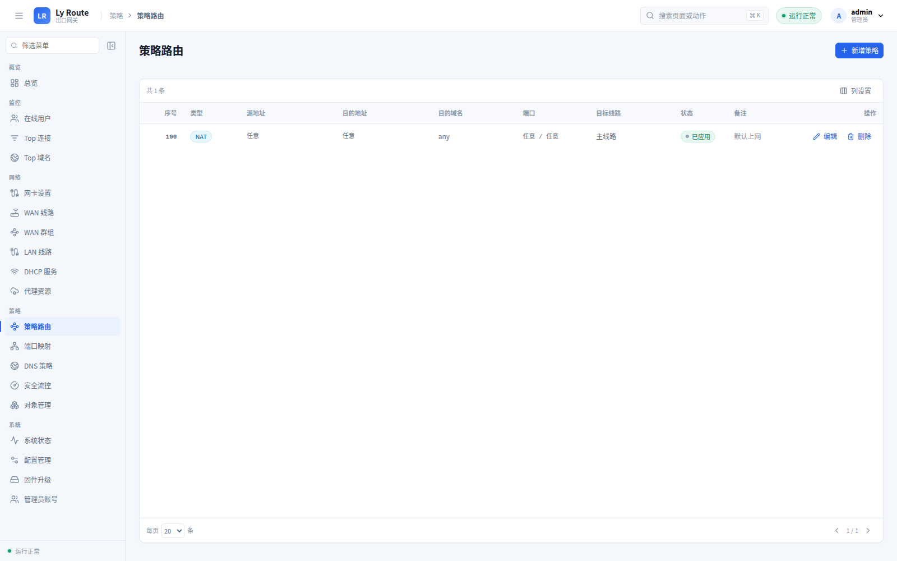

<p align="center">
  
</p>

<h1 align="center">Ly Route 出口网关 1.5.7</h1>

<p align="center">
面向 x86-64 与 ARM64 设备的企业出口网关<br>
多线接入 · 策略路由 · 域名分流 · NAT · DNS 策略 · 流量控制 · 代理出口
</p>

> **发布仓库说明**：本仓库只提供安装 / 升级产物、产物组装工程与第三方组件声明，
> 不包含产品源代码。软件使用受 [EULA](EULA.md) 约束。
>
> **平台**：x86_64 提供 ISO 安装镜像与升级包；ARM64 提供 Armbian Bookworm 一键安装包与升级包。
> 二进制产物在 **Releases** 中，不在 git 文件树里。

## 下载

最新正式版：**[v1.5.7](https://github.com/kwrum1/ly-route/releases/tag/v1.5.7)**

| 平台 | 产物 | 用途 |
| --- | --- | --- |
| x86_64 | [`ly-route-gateway-gui-installer.iso`](https://github.com/kwrum1/ly-route/releases/download/v1.5.7/ly-route-gateway-gui-installer.iso) | 整机安装（BIOS/UEFI 图形安装器） |
| x86_64 | [`ly-route-upgrade-gateway-bookworm-amd64.tar.zst`](https://github.com/kwrum1/ly-route/releases/download/v1.5.7/ly-route-upgrade-gateway-bookworm-amd64.tar.zst) | 原地升级 |
| ARM64 | [`ly-route-gateway-arm64-installer.tar.zst`](https://github.com/kwrum1/ly-route/releases/download/v1.5.7/ly-route-gateway-arm64-installer.tar.zst) | Armbian Bookworm 一键安装 |
| ARM64 | [`ly-route-upgrade-gateway-bookworm-arm64.tar.zst`](https://github.com/kwrum1/ly-route/releases/download/v1.5.7/ly-route-upgrade-gateway-bookworm-arm64.tar.zst) | ARM64 原地升级 |

校验文件：[`SHA256SUMS`](https://github.com/kwrum1/ly-route/releases/download/v1.5.7/SHA256SUMS)

## 功能

| 领域 | 能力 |
| --- | --- |
| 网络接入 | 多 WAN、PPPoE / DHCP / 静态 IP、链路聚合、WAN 群组（主备 / 权重 / 五元组 / 带宽 / 连接数） |
| 内网 | LAN 线路、DHCP 地址池、静态分配、IPv6 与路由通告 |
| 分流 | 策略路由（源 / 目的地址、端口、协议、域名组）、按顺序匹配、默认策略 |
| 域名分流 | 域名组与策略绑定，解析结果自动跟随策略出口，不限于内置域名库 |
| NAT | 端口映射、一对一静态 NAT、全锥型 NAT |
| DNS | 多解析上游与上游组、按域名 / 源 IP 指定线路、代理解析、域名拉黑 |
| 流控 | 按规则限速与阻断，支持上行 / 下行 / 双向 |
| 运维 | 事务化应用、配置导出 / 导入 / 快照、在线升级、组件健康、温度保护 |

## 安装

**x86_64**：下载 `ly-route-gateway-gui-installer.iso`，使用 `dd`、Rufus（DD 模式）或
balenaEtcher 写入 U 盘，目标机选择 BIOS 或 UEFI 启动，按向导选择磁盘、管理网口与
管理地址，设置管理员密码后安装。

**ARM64**（需已安装 Armbian Bookworm arm64，保留板卡内核 / DTB / 引导）：

```bash
curl -fL -o /tmp/ly-route-arm64.tar.zst \
  https://github.com/kwrum1/ly-route/releases/latest/download/ly-route-gateway-arm64-installer.tar.zst
mkdir -p /tmp/ly-route-installer
tar --use-compress-program=unzstd -xf /tmp/ly-route-arm64.tar.zst -C /tmp/ly-route-installer
cd /tmp/ly-route-installer/ly-route-gateway-arm64-installer
sha256sum -c checksums.sha256
sudo ./install.sh
```

安装脚本幂等，可重复执行；已有的 `/etc/ly-route/runtime.env` 与
`/etc/ly-route/appliance.env` 不会被覆盖。默认管理地址 `https://192.168.88.254/`，
初始密码见 `/root/ly-route-initial-admin-password`，首次登录需修改。

安装完成后用浏览器访问 `https://<管理地址>/`。

## 升级

Web 控制台：**系统 → 固件升级**，上传与架构匹配的升级包并安装。升级过程中控制服务
会重启，页面显示“系统重启中”，完成后自动恢复；业务配置与管理地址保留。

完整步骤、API 方式与回滚说明见 [安装与升级](docs/INSTALL.md)。

## 文档

- [安装与升级](docs/INSTALL.md)
- [使用手册](docs/USER-GUIDE.md)
- [API 参考](docs/API.md)
- [常见问题](docs/FAQ.md)

## 界面

<p align="center">
  
</p>

| 网卡设置 | 策略路由 |
|---|---|
|  |  |

| DNS 策略 | 系统状态 |
|---|---|
|  |  |

更多界面见 [docs/](docs/)。

## 系统要求

- **x86_64**：4 GB 以上系统盘、至少 2 个网口（1 个管理口 + 1 个数据口）；
- **ARM64**：Armbian Bookworm arm64、root 权限、网络可访问 Debian 软件源、至少 2 个网口；
- 管理口保留在系统内，不参与数据转发。

## 完整性校验

```bash
sha256sum -c SHA256SUMS
```

v1.5.7 的 SHA256：

```text
7e3451ac77942a43c4fc95d1292cad57d6baf86612719ae049718c195646ad5c  ly-route-upgrade-gateway-bookworm-amd64.tar.zst
18a7a276a259a721e539216dfcd1d220f73c3820975a0b42f041189c67387c78  ly-route-gateway-gui-installer.iso
7f6f68d6d0a3c88ea3b21fa61f63be9916cdd9cba878987f39664493f30a7b35  ly-route-gateway-arm64-installer.tar.zst
6a4cdd46c98efc6ff20bc18a55de88f204d4470c8fb875df8648cc1ff59080bb  ly-route-upgrade-gateway-bookworm-arm64.tar.zst
```

## 仓库结构

```text
.
├── README.md                 产品说明与下载
├── EULA.md                   最终用户许可协议
├── NOTICE.md                 版权与商标声明
├── THIRD-PARTY.md            第三方组件清单与合规说明
├── SECURITY.md               安全问题报告方式
├── licenses/                 随附的许可证全文（Apache-2.0 / GPL / MPL / BSD）
├── docs/                     安装、升级、使用、API 与打包说明
├── packaging/                产物组装脚本（不含产品源码）
└── .github/workflows/        GitHub Actions：从二进制输入组装产物并发布
```

## 打包与 CI

本仓库的 CI 不编译产品源码，只把已发布的二进制输入组装为可安装产物：

- **x86_64**：上一版本 ISO（启动骨架与基础 rootfs）+ 目标版本 x86 升级包 → 新 ISO；
- **ARM64**：上一版本 ARM 安装包（overlay 与 packages）+ 目标版本 ARM 升级包 → 新 ARM 安装包。

说明见 [docs/PACKAGING.md](docs/PACKAGING.md) 与 [`packaging/`](packaging/)。

## 许可证与第三方组件

- 产品本身为闭源商业软件，使用条款见 [EULA.md](EULA.md)；
- 第三方组件按各自许可证授权，清单、版本与上游源码地址见 [THIRD-PARTY.md](THIRD-PARTY.md)；
- 相关许可证全文见 [`licenses/`](licenses/)。

## 问题反馈

- 功能与安装问题：GitHub Issues；
- 安全漏洞：请勿公开提交，按 [SECURITY.md](SECURITY.md) 私下报告。
